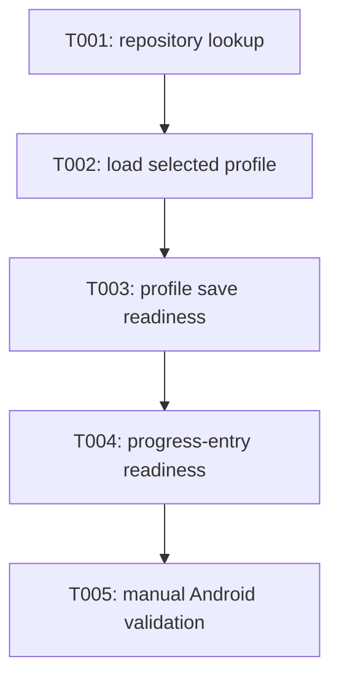

# Tasks: Young Profile and Entry Validation

**Input**: Design documents from `/specs/005-young-form-validation/`

**Prerequisites**: [plan.md](plan.md), [spec.md](spec.md), [research.md](research.md), [data-model.md](data-model.md), [contracts/](contracts/), [quickstart.md](quickstart.md)

**Tests**: No automated test tasks are included, as required by the project constitution. Verify manually using [quickstart.md](quickstart.md).

**Organization**: Tasks are grouped by user story and ordered by dependencies. The single-profile repository lookup is foundational because the detail-screen stories depend on loading the selected saved record.

## Format: `- [ ] [TaskID] [P?] [Story?] Description with file path`

- **[P]**: Used only when a task can safely run in parallel with another task.
- **[Story]**: Required for user-story tasks; maps to `spec.md` user stories.
- Every task names the source or validation file it changes or uses.

## Phase 1: Setup

**Purpose**: Project initialization and dependencies.

No setup changes are required. The existing Expo, Expo SQLite, React Native, and NativeWind dependencies are already present in `package.json`; do not add packages or test infrastructure.

---

## Phase 2: Foundational

**Purpose**: Provide the selected young-person record to the details screen before either story depends on it.

- [X] T001 Add a typed lookup by young-person ID that returns the matching `Young` record or `null` using the existing SQLite repository pattern in `db/repository.ts`.

**Checkpoint**: The repository can distinguish a found record from a missing record; user-story work can now proceed.

---

## Phase 3: User Story 1 - Edit the correct young person's profile (Priority: P1) 🎯 MVP

**Goal**: Load the selected saved profile, recover safely if it is absent or fails to load, and enable saving only when name, age, and gender values are present.

**Independent Test**: Open a saved young person's details and confirm the displayed name matches the saved record. Clear the name or age and confirm **Salvar** is unavailable; restore all values and confirm it is available. Verify existing age validation still applies. Open details for a missing profile and confirm the exact error toast is shown for two seconds before returning to the previous screen.

### Implementation for User Story 1

- [X] T002 [US1] Replace the fabricated sample profile with the record loaded by route ID; initialize name, age, and gender from it; on missing profile or profile/details loading error show `Não foi possível exibir as informações do jovem. Tente novamente` in the existing toast, keep it visible for two seconds, then call `router.back()` without rendering sample data in `app/young/[youngId].tsx`.
- [X] T003 [US1] Disable **Salvar** until the profile is loaded and trimmed name, non-empty age text, and selected gender are present; preserve existing validation and apply `bg-sky-700` with a distinguishable disabled state in `app/young/[youngId].tsx`.

**Checkpoint**: The profile story is independently usable with a real saved record and a manually observable unavailable state for missing required values.

---

## Phase 4: User Story 2 - Add a non-empty progress entry (Priority: P2)

**Goal**: Prevent empty progress entries and use the shared button color without changing successful report behavior.

**Independent Test**: With a loaded young person's details open, confirm **Adicionar relato** is unavailable for empty or whitespace-only text and available for non-whitespace text. Submit a valid report and confirm it appears in the history, the input clears, and the action becomes unavailable again.

### Implementation for User Story 2

- [X] T004 [US2] Disable **Adicionar relato** when trimmed report text is empty, preserve existing report-length validation, persistence, ordering, toast, and clearing behavior, and apply `bg-sky-700` with a distinguishable disabled state in `app/young/[youngId].tsx`.

**Checkpoint**: A valid report remains addable, while empty reports cannot be submitted.

---

## Phase 5: Polish & Cross-Cutting Concerns

**Purpose**: Verify the integrated feature against the required manual flows.

- [ ] T005 Run the Android launch and manually execute every applicable scenario in `specs/005-young-form-validation/quickstart.md`; record the target, results, and any limitations in the change review.

---

## Dependencies & Execution Order

### Phase Dependencies

- **Setup (Phase 1)**: No changes; existing project dependencies are sufficient.
- **Foundational (Phase 2)**: T001 provides the focused profile read and must complete before profile screen work.
- **User Story 1 (Phase 3)**: Depends on T001; delivers profile loading, the missing/error toast-and-back recovery, and save-readiness behavior as the MVP.
- **User Story 2 (Phase 4)**: Follows User Story 1 because both stories update the same details screen and the report flow must use the loaded selected profile.
- **Polish (Phase 5)**: T005 depends on both stories being implemented.

### User Story Dependencies

### Parallel Opportunities

- No implementation tasks are marked parallel: T001 is a prerequisite, and the user-story changes all touch `app/young/[youngId].tsx`.
- Once implementation is complete, manual validations from the quickstart can be performed as one contiguous screen workflow; there are no safe cross-story code tasks to split across parallel workers.

## Parallel Execution Examples

### User Story 1

T002 and T003 modify the same screen and are intentionally sequential. T001 must be complete first; there are no safe parallel code tasks within this story.

### User Story 2

T004 is a single screen task and follows User Story 1; there are no safe parallel code tasks within this story.

## Implementation Strategy

### MVP First (User Story 1)

1. Complete T001 to expose a profile lookup by ID.
2. Complete T002 and T003 to load the actual saved profile and gate **Salvar**.
3. Manually verify the User Story 1 independent test on Android before proceeding.
4. Stop at this point for an MVP that removes the fabricated profile, correctly gates profile saving, and handles missing/failed profile loading with the specified toast and return navigation.

### Incremental Delivery

1. Complete the foundational lookup and User Story 1; manually verify the saved profile and save readiness.
2. Complete User Story 2; manually verify the empty/non-empty report cases and preserved successful submission behavior.
3. Complete T005 and record the full Android verification results.

## Notes

- Every task follows the required checkbox, sequential ID, optional parallel marker, required user-story label where applicable, and concrete file-path format.
- Automated tests are intentionally omitted under the project constitution.
- Profile-update persistence is out of scope; preserve the current profile save behavior as specified.
- T005 remains incomplete: `npx expo start --android` found port 8081 occupied; the user declined using port 8082, so Android startup and manual device checks were not verified. `npm run typecheck` and `npx expo export --platform web` succeeded.